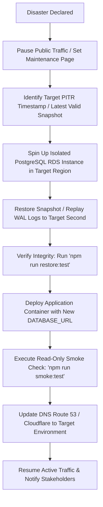

# Phase 11C — Backup & Disaster Recovery (DR)

## 1. Objectives & Targets

- **Recovery Time Objective (RTO):** $< 4\text{ hours}$ (Full application and database restore).
- **Recovery Point Objective (RPO):** $< 15\text{ minutes}$ (Maximum potential data loss window via continuous WAL archiving).
- **Statutory Retention:** 8 Financial Years for financial ledgers, commercial documents, and inventory transactions.

---

## 2. Backup Strategy & Schedules

### Database (PostgreSQL)

- **Automated Daily Snapshots:** Automated nightly snapshot taken at 02:00 IST. Retained for 35 days.
- **Continuous WAL Archiving (PITR):** Write-Ahead Logs streamed continuously to durable cloud object storage, enabling point-in-time recovery to any second within the retention window.
- **Monthly Cold Storage Archives:** End-of-month snapshots exported and archived with 8-year statutory retention.
- **Tooling:** Verified via `npm run backup:run` (`scripts/backup-database.ts`).

### Object Storage (Uploaded Documents & Scans)

- **Versioning:** S3 Object Versioning enabled on `kdipl-production-documents`.
- **Cross-Region Replication (CRR):** S3 bucket replication from `ap-south-1` (Mumbai) to secondary India region `ap-south-2` (Hyderabad).
- **MFA Delete:** Multi-Factor Authentication required to permanently delete object versions.

---

## 3. Disaster Recovery Failover Procedure (Step-by-Step)

### Procedure Steps:

1. **Declaration & Incident Command:** Operational Lead declares disaster status and notifies MD and Directors.
2. **Traffic Suspension:** Switch Cloudflare/Route 53 to static 503 maintenance page.
3. **Database Spin-Up:** Launch target PostgreSQL instance from latest automated snapshot in AWS Mumbai or Hyderabad.
4. **WAL Replay:** Apply transaction logs up to the exact transaction prior to corruption or outage.
5. **Integrity Drill Execution:** Run `npm run restore:test` (`scripts/restore-database.ts`) to verify schema version, table counts, and balance math.
6. **Application Deployment:** Deploy candidate application release SHA pointing to the restored database endpoint with `sslmode=verify-full`.
7. **Smoke Verification:** Run `npm run smoke:test` (`scripts/run-smoke-tests.ts`) to confirm read-only endpoints, login, and ledger balances.
8. **DNS Switch:** Point domain `erp.kdipl.in` to new production cluster IP/CNAME.
9. **Post-Recovery Audit:** Reconcile Tally export outbox and inventory balances before unlocking financial posting.
